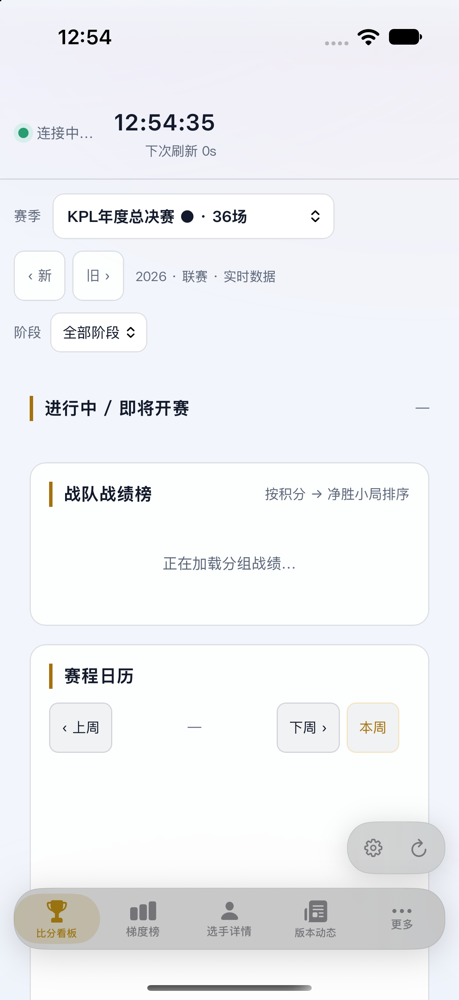
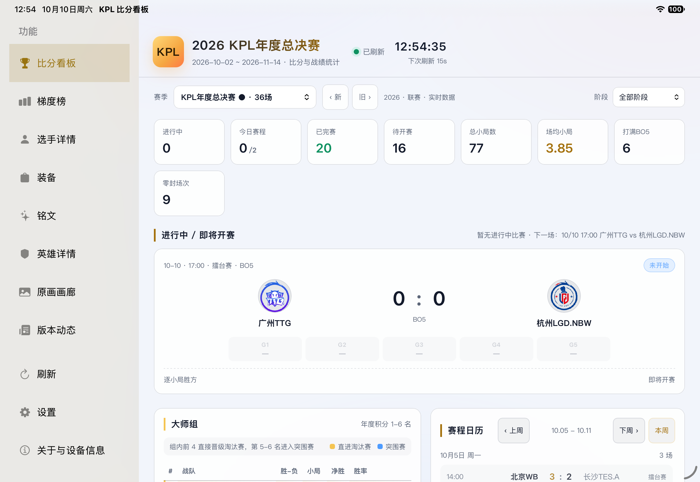
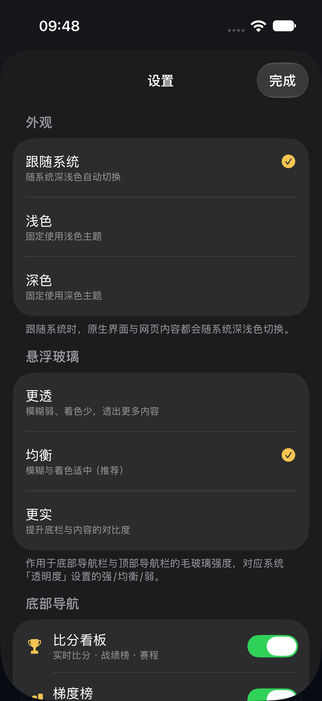

<div align="center">

# KPLBoard

**王者荣耀职业联赛（KPL）一站式数据台 · 三端原生实现**

iOS / iPadOS · macOS · HarmonyOS 各一套独立原生工程，同一个数据模型、同一套前端页面。

[](#-license)
[](#-三个端)
[](#-技术栈)
[](#-技术栈)

</div>

---

## 目录

- [这是什么](#-这是什么)
- [三端截图](#-三端截图)
- [三个端](#-三个端)
- [仓库结构](#-仓库结构)
- [快速上手](#-快速上手)
- [技术栈](#-技术栈)
- [数据来源](#-数据来源)
- [离线数据](#-离线数据)
- [版本](#-版本)
- [路线图](#-路线图)
- [参与贡献](#-参与贡献)
- [免责声明](#-免责声明)
- [License](#-license)

---

## 这是什么

KPLBoard 把「看比赛」需要的所有信息收进一个 App：

- **比分看板** —— 实时比分（进行中 / 即将开赛 / 已结束）、赛季切换、战队战绩榜、赛程日历、六项概览 KPI。
- **工具箱（7 个模块）** —— 英雄梯度榜（T0–T3，贝叶斯平滑）、选手详情（KDA / 经济 / 场均伤害 / 英雄池）、
  英雄详情（技能 / 属性评分 / 背景故事 / 历史上的 TA）、装备图鉴、铭文图鉴、皮肤原画画廊、官网版本动态。
- **离线可用** —— 三个上游通道端内直连，不需要自建服务；安装包内附种子数据，断网也能完整浏览历史赛季与资料库。

比赛数据 **20 秒一轮** 刷新（进行中），已结束比赛缓存 600 秒，赛季清单落盘复用。

---

## 三端截图

| iPhone | iPad Pro 11″ | 设置页 |
| :--: | :--: | :--: |
|  |  |  |

> 截图来自 iOS 端真机 / 模拟器实测。三端共用同一套前端页面，视觉与交互保持一致。

---

## 三个端

| | [iOS / iPadOS](iOS/) | [macOS](MacOS/) | [HarmonyOS](HarmonyOS/) |
|---|---|---|---|
| 语言 / UI | Swift 5 · SwiftUI · WebKit | Swift 5 · SwiftUI · WebKit | ArkTS · ArkUI（纯原生，无 WebView） |
| 最低系统 | iOS / iPadOS 16.0 | macOS 13.0 Ventura | HarmonyOS API 26 |
| 工程文件 | `KPLBoard-iOS.xcodeproj` | `KPLBoard-MacOS.xcodeproj` | DevEco Studio 工程（`hvigorfile.ts`） |
| 应用标识 | `com.local.kplboard` | `com.local.kplboard.macos` | `com.ccgo.kplboard` |
| 当前版本 | 1.3.1 | 1.4.0 | 1.0.0 |
| 设备形态 | iPhone 单列 / iPad 侧栏 + 双栏 | 桌面窗口 + 工具栏 | 手机底部页签 / 平板左右分栏 |
| 构建 | Xcode 直接 Run，或 `./package-ipa.sh` | Xcode 直接 Run，或 `./build-dmg.sh` | `bash build-hap.sh`（无需打开 IDE） |
| 第三方依赖 | 无 | 无 | 无 |

**为什么三套工程而不是一套跨平台代码？** 三端各自把「平台必需的适配」做到位（导航范式、安全区、
菜单栏与快捷键、断点与折叠屏、窗口尺寸），共用的是数据模型、数据源与前端页面，而不是硬塞一层跨平台框架。

---

## 仓库结构

```
KPLBoard/
├── iOS/                 # iOS / iPadOS 原生版（Swift + SwiftUI + WKWebView）
│   ├── KPLBoard-iOS.xcodeproj/
│   ├── KPLBoard-iOS/
│   │   ├── App/         # 入口、导航、设置、WebView 封装、自定义 scheme
│   │   ├── Data/        # 数据模型 + 三条上游通道 + 聚合/缓存
│   │   ├── Resources/   # 前端页面（web/）、赛季清单、种子 JSON
│   │   └── Assets.xcassets/
│   ├── docs/            # 真机验证截图
│   ├── package-ipa.sh   # 一键归档导出 ipa
│   └── README.md        # iOS 端详细文档（构建配置 / 布局 / 适配矩阵 / 踩坑）
├── MacOS/               # macOS 原生版（Swift + SwiftUI + WKWebView）
│   ├── KPLBoard-MacOS.xcodeproj/
│   ├── KPLBoard-MacOS/
│   │   ├── App/  Data/  Resources/
│   │   ├── Info.plist
│   │   └── KPLBoard-MacOS.entitlements   # App Sandbox + network.client
│   ├── build-dmg.sh     # 一键打出 dmg
│   └── README.md        # macOS 端详细文档（含逐处适配说明）
├── HarmonyOS/           # 鸿蒙原生版（ArkTS + ArkUI）
│   ├── AppScope/        # app.json5（包名 / 版本 / minAPIVersion）
│   ├── entry/           # 主模块：ets（页面与数据层）+ resources（离线 bundle）
│   ├── build-hap.sh     # 命令行构建 HAP，自动探测 DevEco 安装目录
│   ├── PACKAGING.md     # 打包与真机安装全流程
│   └── QUICKSTART.md    # 换一台电脑直接上手
├── docs/screenshots/    # README 用截图
├── LICENSE
└── README.md
```

---

## 快速上手

### iOS / iPadOS

```bash
cd iOS
open KPLBoard-iOS.xcodeproj      # Xcode → 选中真机或模拟器 → Run
```

真机测试包：`./package-ipa.sh`（Debug 配置，产出 `build/ipa/KPLBoard-iOS.ipa`）。
前置：Xcode 已登录 Apple ID，设备已连接并登记 UDID。

### macOS

```bash
cd MacOS
open KPLBoard-MacOS.xcodeproj    # Xcode → My Mac → Run
```

打 dmg：`./build-dmg.sh`（产物在 `build/`，已加入 `.gitignore`）。
签名：`CODE_SIGN_STYLE = Automatic`，首次打开需在 Xcode 里选自己的 Team。

### HarmonyOS

```bash
cd HarmonyOS
bash build-hap.sh                # 默认 debug 包；bash build-hap.sh release 出 release 包
```

需要 **DevEco Studio 26.0.0.851+**（自带 SDK / Node / JDK / hvigor，不用另装 JDK）。
`build-hap.sh` 会自动探测 DevEco 安装目录，也可以显式指定：

```bash
DEVECOROOT="/Applications/DevEco-Studio.app/Contents" bash build-hap.sh
```

真机安装需要签名（调试证书绑定设备 UDID），完整流程见 [HarmonyOS/PACKAGING.md](HarmonyOS/PACKAGING.md) 与
[HarmonyOS/QUICKSTART.md](HarmonyOS/QUICKSTART.md)。

---

## 技术栈

| 层 | iOS / macOS | HarmonyOS |
|---|---|---|
| UI | SwiftUI（`NavigationStack` / `NavigationSplitView`） | ArkUI 声明式组件（`Column` / `Row` / `Grid` / `Scroll`） |
| 页面 | `WKWebView` + 自定义 scheme `kplboard://app/` 拼成「同源站点」 | ArkTS 直接绘制，无 WebView |
| 数据 | `URLSession` + `actor` 仓储 + JSON 落盘缓存 | `resourceManager` 直读 rawfile + `AppStorage` 状态 |
| 图片 | 白名单代理 + `Referer` + 本地缓存 | 按 `densityPixels` 取档 + 懒拷贝到 `cacheDir` |
| 适配 | 设备形态 / 尺寸类别 / 安全区 | 官方 sm / md / lg 断点 + `windowSizeChange` |

**零第三方依赖**：没有 CocoaPods、没有 SPM、没有 npm 包。前端页面是纯静态 HTML/CSS/JS，随包内置。

---

## 数据来源

| 通道 | 用途 |
|---|---|
| 玩加赛事（WanPlus） | 实时比分主源（按周拉取）、历史赛程归档（HTML 解析） |
| KPL 官方 | 官方赛程接口 + 官方统计通道（2023+ 赛季梯度榜 / 选手榜） |
| PandaScore（esportsresults.com） | 补齐逐小局胜方；官方源不可用时全程兜底 |

三条通道在端内直连，**不需要自建服务端**；合并、状态推断、积分榜计算全部在客户端完成。

---

## 离线数据

安装包内置种子数据，断网也能完整查看历史赛季与资料库：

| 端 | 内容 | 体积 |
|---|---|---|
| iOS / macOS | `Resources/data/tools/` 299 个种子 JSON | ≈ 12–13 MB |
| HarmonyOS | `rawfile/bundle/` 369 个接口快照 + 2036 张图片 | ≈ 48 MB |

这两份数据是用脚本从上游批量抓取后固化进仓库的，所以仓库本身可以直接 clone 下来构建，
**不依赖联网拉数据**。

---

## 版本

| 端 | 版本 | 说明 |
|---|---|---|
| HarmonyOS | 1.0.0 | 从 WebView 壳重写为纯 ArkTS 原生渲染，删除包内 48 MB 网页 |
| macOS | 1.4.0 | 接入 KPL 官方统计通道，补齐 2023+ 赛季梯度榜 / 选手榜 |
| iOS / iPadOS | 1.3.1 | 一套代码适配 iPhone 12 Pro Max 与 iPad Pro 11″（M2） |

各端的详细变更与踩坑记录写在各自的 `README.md` / `PACKAGING.md` 里。

---

## 路线图

- [ ] 三端共用一份 `events.json` / 种子数据的同步脚本入库
- [ ] 比分看板支持手动选择「只看某支战队」
- [ ] iPad 多窗口下赛季状态跨窗口共享
- [ ] 构建产物通过 GitHub Releases 分发

---

## 参与贡献

1. Fork 本仓库并新建分支：`git checkout -b feat/your-feature`
2. 提交前请确认构建产物没有被带入（`git status` 应看不到 `build/`、`*.hap`、`DerivedData/`）
3. 提交 Pull Request，说明改动落在哪个端、影响哪些模块

Issue 里请带上：端（iOS / macOS / HarmonyOS）、系统版本、复现步骤、截图或日志。

---

## 免责声明

本项目是**非官方的个人练习与自用项目**，与腾讯、天美工作室、KPL 官方、华为、Apple 均无关联。
所有赛事数据、英雄 / 装备 / 铭文资料、皮肤原画的著作权归各自权利人所有，本项目仅做展示用途。
请勿用于商业用途；如需商用，请自行取得上游数据源的授权。

---

## License

[Unlicense](LICENSE)（公有领域，与仓库原有 LICENSE 一致）
